<p align="center">
  
</p>

<h1 align="center">Pixel Pet</h1>

<p align="center"><a href="https://github.com/DiRaiks/pixel-pet/actions/workflows/ci.yml"></a></p>

<p align="center">
  A pixel-art cube for your macOS desktop that keeps an eye on your Claude Code and Codex agents<br>
  and lets you answer their permission requests without switching windows.<br>
  It shows your limits, answers quick questions (about a file too), translates the selection, reminds you to take a break,<br>
  and can hide in the MacBook notch.
</p>

<p align="center">
  <br>
  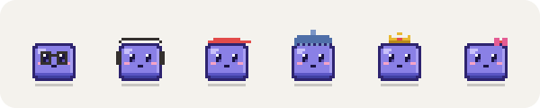<br>
  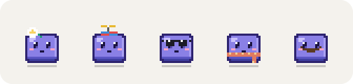
</p>

<p align="center">
  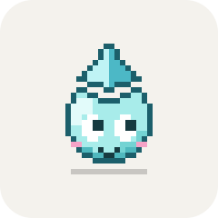<br>
  Or pick <b>LM</b> instead of the cube. Where the cube rolls over, LM catches a drop or melts into a puddle:<br>
  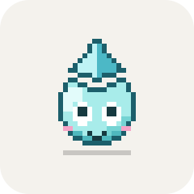
  
</p>

## Contents

- [What it does](#what-it-does)
- [Install](#install)
- [Agents](#agents): [blocks](#agent-blocks), [status panel](#status-panel), [permission requests](#answering-permission-requests), [notifications](#notifications), [what the cube is telling you](#what-the-cube-is-telling-you), [at the keyboard](#at-the-keyboard)
- [Your day](#your-day): [breaks](#breaks), [calls](#calls), [weekly recap](#weekly-recap)
- [Ask and translate](#ask-and-translate)
- [Reacting to the Mac](#reacting-to-the-mac)
- [Examples](#examples)
- [Reference](#reference): [mouse](#mouse), [hotkeys](#hotkeys), [menu bar](#menu-bar), [settings](#settings)
- [What it changes on your Mac](#what-it-changes-on-your-mac), [uninstall](#uninstall), [troubleshooting](#troubleshooting)

## What it does

<table>
<tr>
<td width="25%" align="center"></td>
<td><b>Agents at a glance.</b> Each running session is a small block next to the cube: Claude Code on the right, Codex on the left. Teal while it works, amber while it waits for you, red if it fails. The cube types on its keyboard while anything works, and a click shows what each agent is doing right now, with a clock.</td>
</tr>
<tr>
<td align="center"></td>
<td><b>Knows when you are needed, and lets you answer.</b> A permission prompt, a question or a plan to approve makes it bounce with a "!" until you answer. For Claude Code's permission requests a card opens by the cube with the command or file, Allow and Deny. When the cube can't be seen, a silent notification says so instead.</td>
</tr>
<tr>
<td align="center"></td>
<td><b>Celebrates finished work.</b> A jump when a turn with real work ends, and a somersault with confetti after a task of 10 minutes or more.</td>
</tr>
<tr>
<td align="center"></td>
<td><b>Limits.</b> The 5-hour and weekly usage show in the status panel and the menu bar. As the 5-hour window drains, the cube empties from the top. Near the limit it turns pale and sweats.</td>
</tr>
<tr>
<td align="center">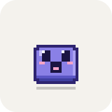</td>
<td><b>Questions, about a file too.</b> ⌃⌥K asks Claude in a card next to the cube. Drop a file on the cube and it swallows it: the card opens with the file attached. ⌃⌥T translates the selected text.</td>
</tr>
<tr>
<td align="center"></td>
<td><b>Breaks and your week.</b> After an hour without a break it holds up a steaming mug. On Monday it reads a newspaper: last week's recap of what your agents did.</td>
</tr>
<tr>
<td align="center"></td>
<td><b>Home in the notch.</b> Drop it anywhere along the top edge of a screen and it slips into the notch, or into a small burrow on displays without one. From there only its eyes show, and it peeks out when something needs you.</td>
</tr>
<tr>
<td align="center"></td>
<td><b>Touch your YubiKey.</b> When a GPG signature (a signed commit, for one) waits for the key's button, the cube pulls out a little YubiKey and holds it up with the pad blinking, then cheers with a check mark once you touch it.</td>
</tr>
<tr>
<td align="center">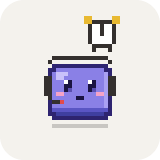</td>
<td><b>Calls coming up.</b> With "Remind about calls" on, it puts on a headset 5 minutes before a meeting with a call link, and the alarm clock rings in the last minute.</td>
</tr>
<tr>
<td align="center"></td>
<td><b>Desktop life.</b> Its eyes follow the cursor. It falls asleep when you are away, yawns and rolls now and then, gets shy when you hover over it, gets cross if you click it too much, and notices your Mac: headphones, music, a call on air, the heat, a screenshot.</td>
</tr>
</table>

The app runs entirely on your Mac. It never talks to the network itself; the only network access is through the Claude Code CLI you already use.

> The interface is in English by default; Settings → Language switches it to Russian.

## Install

You need:

- macOS 26 or later, on Apple silicon or Intel.
- Swift 6.2 or later. The Command Line Tools are enough; Xcode is not required.
- [Claude Code](https://docs.claude.com/en/docs/claude-code), either as the `claude` CLI on your `PATH` or bundled with the Claude desktop app. Questions, Claude translation and limit checks use your Claude subscription.

There is no signed download yet, so the app is built from source:

```bash
git clone https://github.com/DiRaiks/pixel-pet.git
```

```bash
cd pixel-pet && ./scripts/install.sh
```

`install.sh` builds a release app bundle, copies it to `~/Applications/PixelPet.app` and launches it. Running it again updates the app in place. A failed build leaves the running copy alone.

On first launch, a welcome window walks you through two steps and lists the hotkeys:

1. **Connect to Claude Code** (menu: "Connect to Claude Code…"). This adds the pet's hooks to `~/.claude/settings.json`; the file is backed up first. See [What it changes on your Mac](#what-it-changes-on-your-mac).
2. **Allow Accessibility.** This is needed only for ⌃⌥T, to read the selected text.

The first time a translation language pack is missing, the translation card offers a button to download it.

Agent sessions that are already open get picked up as soon as they send their next event. You do not need to restart them.

## Agents

### Agent blocks

Agent blocks stack beside the cube, one per session: Claude Code on the right, Codex on the left.

<p></p>

| Block | Meaning |
|---|---|
| Teal, spinning | Working |
| Amber, bouncing | Waiting for you |
| Red | Failed |
| Grey | Idle |
| Green flash | Just finished |
| Dot on a block | Subagents are running |
| Ellipsis on top | More than 4 sessions on that side |

Codex blocks never turn amber: Codex doesn't write "waiting for approval" to its session files, which is where the pet reads it from.

### Status panel

Click the cube for the status panel: the 5-hour and weekly limits, and per session what the agent is doing right now, with a clock that counts seconds.

<p>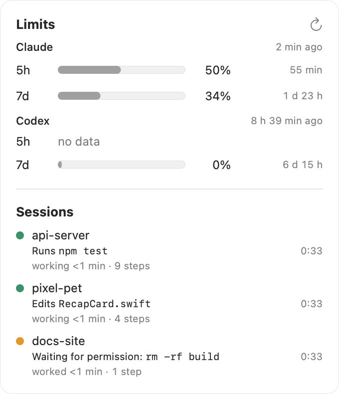</p>

- The step: "Runs `npm test`", "Edits `App.swift`", "Searches `onGone`", "Thinking" between tools, "Waiting for permission: `rm -rf build`", "Waiting for an answer".
- Under it, how long the turn has run and how many steps it took; afterwards "Done 5 min ago, took 12 min".
- Model and context fill on the right, and "+2 sub." while subagents run.
- Codex reports no tools, so its rows show only the turn's clock.

### Answering permission requests

When Claude Code asks for permission (a command, a file change, a web page, an MCP tool), a card opens by the cube with what it wants to do and the model's one-line reason: the command, file or URL in large type, any other parameters of the tool in small `key: value` lines under it. Long commands scroll inside the card.

<p>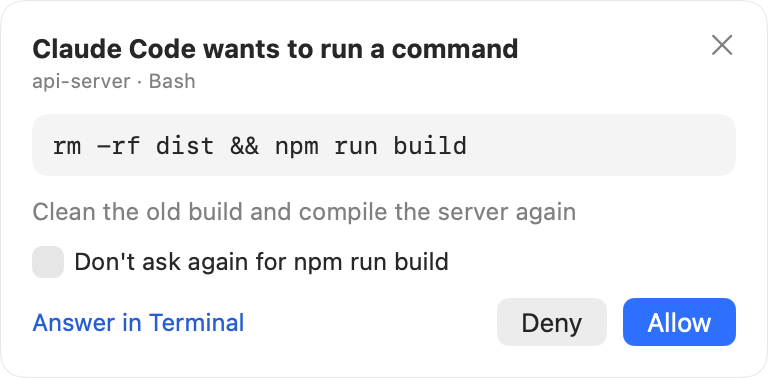</p>

- **Allow** / **Deny** answer at once; the agent goes on (or gets the refusal).
- **Don't ask again** appears when Claude Code offers a rule for it, like "Yes, don't ask again" in the terminal.
- **Answer in Terminal / VS Code / Claude** (or ✕) hands it back: Claude Code asks the usual way where the session runs, and that app comes to the front.
- Several requests show one at a time ("1 of 2").

In a terminal or editor, Claude Code doesn't show its own prompt while the card waits; after a minute without an answer it does. The Claude app shows its own dialog at the same time: answer in either place, the first answer counts and the other one closes. The card only waits while the cube is on screen (not hidden, covered or in do-not-disturb). Its buttons wake up half a second after a request appears, so a stray click can't answer one you haven't read. The command is shown in the card only and never stored or logged. Codex requests aren't covered: its approvals don't reach the pet.

### Notifications

While the cube can't be seen (hidden, covered, behind a fullscreen app), agents reach you through silent macOS notifications: banners with no sound or badge.

- **Needs permission** or **asks a question**: unless the permission card by the cube is already showing it.
- **Done**: after a turn of 20 seconds or more, with how long it worked and how many steps it took.
- **Stopped with an error.**
- **Touch your YubiKey**: when a GPG signature waits for the key and the YubiKey hint is on.

Each session has at most one notification: a new one replaces it, and it goes away once the session works again, gets its answer or ends (the key's once it's touched). A click brings up the app the session runs in. Notifications carry only the project and what happened, never the command, file or question, since Notification Center keeps a history. macOS asks for permission the first time one is sent; Focus and the cube's do-not-disturb keep them quiet. Settings → Notifications: off, when the cube can't be seen (the default), or always.

### What the cube is telling you

States are listed in priority order; a higher one wins.

| | State | Meaning |
|---|---|---|
|  | **Error**: shakes, then gets dizzy | An agent's turn failed within the last 3 seconds |
|  | **Alert**: bounces with "!" | An agent waits for a permission: a command or file change to approve |
| 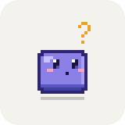 | **Question**: leans in under a "?" | An agent waits for an answer: a question, a plan to approve, or a turn that ended with a question |
|  | **Break**: a steaming mug | An hour at the Mac without five minutes away (see [Breaks](#breaks)) |
| 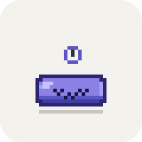 | **Spent**: lies flat, a clock ticking | A limit is used up (100%); agents can't work until it resets |
|  | **Low limit**: pale, sweating | 5-hour usage is at 85% or more, or weekly usage at 90% or more |
|  | **Working**: typing in bursts of uneven length, looking up at the screen between them | At least one agent is working |
|  | **News**: reading a newspaper | The weekly recap is in; a click opens it (see [Weekly recap](#weekly-recap)) |
|  | **Idle**: breathes, blinks, looks around | Nothing is going on |
| 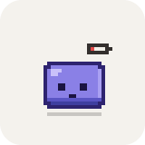 | **Tired**: droopy, a red battery | Idle on a MacBook with 20% battery or less, not plugged in |
|  | **Sleep**: nightcap and a bubble | Idle, and you have been away longer than the sleep setting |

A YubiKey waiting for a touch and a file held over the cube come before all of these; a call about to start comes right after the question.

On top of these, it plays one-off animations:

|  |  |  |  |
|:---:|:---:|:---:|:---:|
| A turn with 20 s+ of work finished | A task of 10 min+ finished | You clicked it, or came back | Dragged, then dropped |
|  |  |  |  |
| Idle fidget: a yawn | Idle fidget: a roll (LM: a drop or a puddle) | Cursor resting on it for 2 s | 5 clicks in 3 s |
|  | 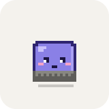 | 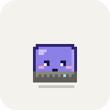 | 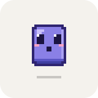 |
| The 5-hour limit reset | Subagents start, and come back | Claude compacts its context | Thrown hard, into a wall |
|  | 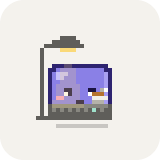 |  |  |
| Shaken while dragged | From 10 pm: a lamp and tea | A file dropped on it: swallowed | A folder or an app dropped on it |
|  | 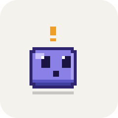 | 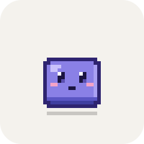 |  |
| A hookah break | An agent has waited on you for over a minute: a wave every ~45 s | An agent's `git push` went through: a rocket | Petted: rub the cursor back and forth over it |
|  | 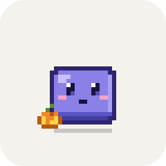 | 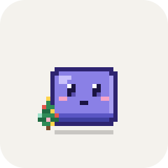 | |
| Idle fidget: a sneeze | October 25–31: a jack-o'-lantern | December 20 – January 7: a little fir | |

When plugged in, the tired cube perks up with a lightning bolt. Now and then, with nothing going on, the cube takes a hookah break (about one idle fidget in four, and sometimes after a big task); every fourth or so ends in one big cloud instead of smoke rings. "Hookah breaks" in Settings turns it off.

At home only the eyes show. The cube peeks out for alerts and errors, and briefly for one-off events.

### At the keyboard

Agents can work for hours, so the typing doesn't run like a metronome: it comes in bursts of uneven length and pace, with pauses to look up at the screen. Every 45–120 seconds the cube has a little moment, and when an agent block changes (one finishes, fails or appears) it looks over at that side.

A bubble over its head shows what the latest Claude Code agent is doing: running a command, searching, reading or editing. It goes away between tools; Codex and MCP tools show none.

| 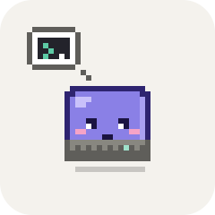 | 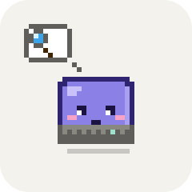 | 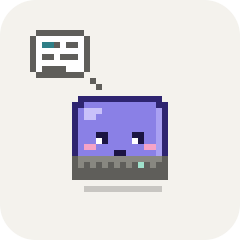 | 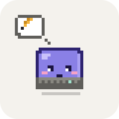 |
|:---:|:---:|:---:|:---:|
| A command (Bash) | Searching (Grep, Glob, WebSearch) | Reading (Read, WebFetch) | Editing (Edit, Write) |

|  |  |  |  |  |
|:---:|:---:|:---:|:---:|:---:|
| A sip of coffee | A stretch | A pause to think, then an idea | A burst of fast typing | A look at a block that changed |

The longer the agents keep at it, the more piles up on the desk: a coffee mug after 10 minutes of work, a headband after 30. The time adds up across turns and agents; pauses of up to 10 minutes (reading an answer, writing the next message) don't count but don't clear the desk either. A longer break does.


Moments and looks follow the "Desktop reactions" setting and Reduce Motion; the props always show.

## Your day

### Breaks

After an hour at the Mac without five minutes away, the cube yawns, stretches and holds up a steaming mug. Click it for "later" (15 minutes); left alone, the mug goes after 3 minutes and comes back 20 minutes on, until you take a break. Five minutes away resets the count, and coming back from a break you'd earned gets a hop. The mug stays out of the way of an agent that needs you, an error, a fullscreen app and do not disturb; the status panel shows "No break for N" when the reminder is near. Any keyboard or mouse input counts as work (the same idle time the cube uses to fall asleep); what you do isn't looked at. Settings → Breaks: off, or every 45, 60 (default) or 90 minutes.

### Calls

Turn on "Remind about calls" and the cube reads your Mac's calendars: 5 minutes before a meeting with a call link it puts on a headset with an alarm clock ticking by its head, and in the last minute the clock rings. The status panel shows the next call. Click the cube to dismiss the reminder for that call. Off by default; macOS asks for calendar access when you turn it on.

### Weekly recap

The cube keeps day sums of what the agents did, and on Monday morning (from 6:00, or the first time it's out later that week) it unfolds a newspaper and reads it until you click it. The click opens the recap of the week before:

<p>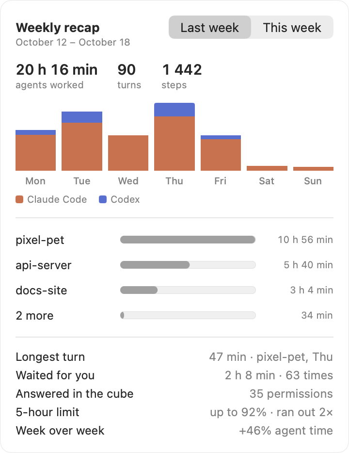</p>

- how long agents worked (waits for you left out), how many turns and steps, per day with Claude Code and Codex stacked;
- the top three projects by time, the rest together;
- the longest turn, how long agents waited for you and how often, permissions answered in the cube, the 5-hour limit's peak and how often it ran out, and the change from the week before.

The newspaper comes only when agents worked on at least two days, and waits behind anything going on (work, a waiting agent, do not disturb, home). The recap is in the menu too, with a switch to this week so far. The sums live in `~/.pixelpet/stats.json`: numbers and project folder names, no commands, files or text, kept for 8 weeks. Settings → Weekly recap turns it off or clears the statistics.

## Ask and translate

<table>
<tr>
<td width="50%"></td>
<td width="50%"></td>
</tr>
<tr>
<td><b>Quick question, ⌃⌥K.</b> Ask Claude in a card next to the cube. The answer streams in, and follow-ups continue the same conversation.</td>
<td><b>Translate the selection, ⌃⌥T.</b> Apple Translation works offline and takes about 0.2 s. "Via Claude" sends the text to Claude instead.</td>
</tr>
</table>

**Quick question.** Press ⌃⌥K, type the question, press Return. Ask a follow-up in the same card. "New" starts a fresh conversation, and Esc closes the card. Settings → "Model for questions" picks haiku, sonnet or opus.

**Ask about a file.** Drag a file from Finder, the desktop or Mail onto the cube: it opens its mouth while the file is over it, swallows it when you let go, and the question card opens with the file attached and a couple of questions to start with ("What's it about?", "Find bugs", "What's in the picture?"), or your own. Up to 3 files at once.

- Text and code go as text, up to 200 000 characters; past that only the beginning, and the card says so.
- PDFs go as their text; a scan as a picture of its first page.
- Images are scaled down to 1568 px.
- Folders, archives, apps and other binaries get a shake of the head.

The file goes to Claude inside the question only when you send it; the CLI runs with no tools, so it never reads anything else on the disk. Follow-ups keep the files in the conversation until "New".

**Translate a paragraph.** Select text in any app and press ⌃⌥T. Text in your language goes to the other language, anything else comes into yours. With the defaults (Russian and English), English becomes Russian and Russian becomes English. While the translation card is open, the cube talks along: 

## Reacting to the Mac

The cube also notices what your Mac is up to. It reads only on/off signals (where sound goes, whether a mic or camera is in use, the thermal and power state, the network, the theme) and asks for no permission. Screenshots are noticed through Spotlight, so they show up after it indexes the file, and not at all where indexing is off. Any Bluetooth audio output counts as headphones. "React to the Mac" in Settings turns all of it off.

|  | 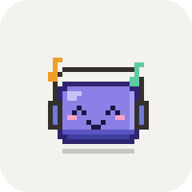 | 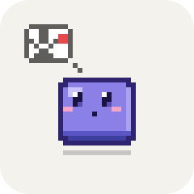 | 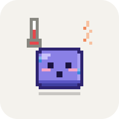 |
|:---:|:---:|:---:|:---:|
| Headphones (Bluetooth or the jack) connected: it puts them on and wears them until they go | Sound playing for 10 s+: it bobs to the beat | A mic or camera in use: it keeps quiet under a recording light | The Mac running hot: a thermometer, sweat |
| 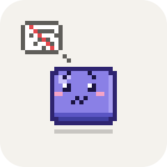 | 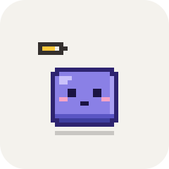 |  |  |
| No network for 5 s+ | Low power mode | Charged to 100% | A screenshot: flash, then ✌️ |
|  |  | 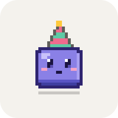 | |
| Switched to dark mode | Switched to light mode: shades on | Friday from 5 pm: a party hat | |

The ongoing ones (music, on air, heat, offline, low power) only replace plain idling: working or waiting agents, errors, calls, sleep and a low battery come first, and idle fidgets pause meanwhile. Among them a mic or camera wins, then heat, the network, low power and music. Virtual audio devices (loopback drivers, call apps' own devices) don't count as sound or a mic, and a paused player's stream moved to the speakers by unplugging headphones doesn't count as music. During a call (on air) the one-off reactions wait. A click on the cube puts the current one away (the next in line shows, if any) until it ends: the call, the music, the heat. Worn headphones take the place of a hat-like accessory.

## Examples

**A typical session.** You start three Claude Code sessions and switch to your browser.

1. Three teal blocks spin next to the cube, and it types on its keyboard. The menu bar shows `3`.
2. One agent asks to run a command it has no permission for. Its block turns amber, the cube bounces with a "!", and a card by it shows the command: you click Allow without leaving what you were doing.
3. Twelve minutes later, the longest task finishes. Its block flashes green, and the cube does a somersault.
4. You go for lunch. With nothing running, the cube falls asleep in its nightcap, and wakes with a hop when you are back.

**Busy day, no distractions.** Press ⌃⌥P. The cube dives into the notch and stays there; only an error brings it out. Press ⌃⌥P again and it stays home but peeks out for alerts again. To bring it back to the desk, drag it out or use "Let out on the desk" in the menu.

**Limits from the terminal too.** If you have no statusline of your own, connecting adds one for terminal sessions. It feeds the pet and prints a compact line:

```text
Opus · ctx 42% · 5h 18% · 7d 9%
```

**See what the hooks report.** Turn on the event log (menu: "Log events") and watch it while an agent runs:

```bash
tail -f ~/.pixelpet/events.log
```

```text
2026-10-19 14:02:11.348 3f9c1a2b pixel-pet promptSubmitted
2026-10-19 14:02:13.902 3f9c1a2b pixel-pet toolStarted Bash
2026-10-19 14:02:15.117 3f9c1a2b pixel-pet toolFinished Bash
2026-10-19 14:02:15.120 3f9c1a2b pixel-pet permissionRequested
2026-10-19 14:03:40.551 3f9c1a2b pixel-pet stopped
```

Only session-id prefixes, project folder names and event names are logged.

## Reference

### Mouse

| Action | What happens |
|---|---|
| Click the cube | It hops and opens the [status panel](#status-panel) |
| Right-click | The context menu, which matches the menu-bar menu |
| Drag | Moves the cube. A quick flick throws it across the screen |
| Drop anywhere along the top edge of a screen | It slides over and dives home into the notch, or the burrow at the top center |
| Drag it out of home | A short tug is enough; it only goes back in if you let go right where it sat |
| Drop a file on it | It swallows it and the question card opens with the file attached ([ask about a file](#ask-and-translate)) |
| Hover over it for 2 s | It gets shy, at most once a minute. This happens only while it is idle on the desk with desktop reactions on and no card open |
| Rub the cursor back and forth over it | It purrs |
| Click it 5 times in 3 s | It gets cross |
| Click it while it holds up the mug | "Later": the break reminder comes back in 15 minutes |
| Click it while it reads the newspaper | The weekly recap opens |
| Click it while it gets ready for a call | The reminder for that call goes away (the card doesn't open) |
| Click it while it bobs to music, keeps quiet on air, sweats or sits offline | That state goes away until it ends |

### Hotkeys

| Keys | Action |
|---|---|
| ⌃⌥K | Ask Claude a quick question. Esc closes the card |
| ⌃⌥T | Translate the selected text |
| ⌃⌥P | Do not disturb: the cube goes home and only comes out for errors |

### Menu bar

The menu-bar icon is a tiny cube with the number of active agents next to it. Its menu has:

- the current limits;
- the status panel and the weekly recap;
- ask, translate and do not disturb;
- send home or let out on the desk;
- show or hide the cube;
- size (×2 to ×6);
- a state picker for previewing animations;
- connect or disconnect Claude Code, and add a statusline for the terminal;
- the event log;
- settings and the welcome window;
- quit.

### Settings

Open settings from the menu (menu: "Settings…", ⌘,):

| Setting | Notes |
|---|---|
| **Look** | |
| Language | English (default) or Russian; switches the whole interface at once |
| Size | ×2 to ×6 |
| Character | The cube, or LM (a drop under a diamond). LM keeps his own aqua colors and wears no accessory, so Color and Accessory are greyed out for him |
| Color | Lavender, mint, peach, graphite, sky, sakura, vanilla or night (dark, for dark wallpapers), or "every day new" |
| Accessory | None, glasses, sunglasses, headphones, cap, beanie, crown, bow, flower, propeller hat, scarf or mustache, or "every day new" |
| **Behavior** | |
| Do not disturb | Same as ⌃⌥P |
| Desktop reactions | Eyes follow the cursor, glances at the app you switch to, the cube fades over fullscreen apps, fidgets |
| React to the Mac | Headphones, music, mic or camera in use, heat, low power, the network, a full battery, screenshots, the theme, Friday evening (on by default) |
| Hookah breaks | On by default |
| Fall asleep after | Never, or 5, 10, 15, 30 or 60 minutes without input |
| Launch at login | Uses a macOS login item |
| **Agents** | |
| Claude Code hooks and statusline | Connect or disconnect them |
| Answer permission requests in the pet | A card by the cube for Claude Code's permission requests (on by default) |
| Model for questions | haiku, sonnet or opus |
| Codex | Follow Codex agents and limits (on by default). Needs nothing installed |
| Event log | Writes to `~/.pixelpet/events.log` |
| **Your day** | |
| Notifications | Off, when the cube can't be seen (default), or always; points to System Settings if macOS has them turned off |
| Breaks | Remind about a break after 45, 60 (default) or 90 minutes of work, or never |
| Weekly recap | Keep day sums for the recap and the Monday newspaper (on by default); clear the statistics |
| Calls | Remind about calls from the Mac's calendars (off by default); shows the access status and how many calendars it sees |
| YubiKey | Show when the key waits for a touch (on by default) |
| **Text** | |
| Translation | Your language and the language to translate it into. Text in any other language is translated into yours |
| Accessibility | Shows the permission status, with a button to request it |

With **Reduce Motion** turned on in macOS (Accessibility → Display), the cube stops jumping, throwing and shaking. Cards open without animation. Looping alarm states hold a single expressive frame instead of animating.

Settings are stored in `~/.pixelpet/config.json`. You can edit it by hand while the app is not running:

```json
{
  "accessory" : "headphones",
  "askModel" : "haiku",
  "breakMinutes" : 60,
  "desktopReactions" : true,
  "doNotDisturb" : false,
  "foreignLanguage" : "en",
  "isHome" : false,
  "nativeLanguage" : "ru",
  "notifications" : "whenHidden",
  "scale" : 4,
  "skin" : "mint",
  "sleepAfterMinutes" : 10,
  "uiLanguage" : "en"
}
```

Missing keys fall back to defaults; the full list is in [ARCHITECTURE.md](docs/ARCHITECTURE.md#configuration).

## What it changes on your Mac

| Path | What |
|---|---|
| `~/.pixelpet/config.json` | Settings, position and the last known limits |
| `~/.pixelpet/stats.json` | Day sums for the weekly recap: agent time, turns and steps per project folder, waits, answers in the cube, the 5-hour limit's peak. No text; 8 weeks kept; written at most once a minute |
| `~/.pixelpet/pet.sock` | Unix socket the hooks talk to. It is readable only by you |
| `~/.pixelpet/bin/pixelpet-hook` | Hook script: `sh` and `nc` forward the hook JSON to the socket and always exit 0. Only a permission request waits for the pet's answer (up to a minute; at once if the pet isn't running, is hidden or in do-not-disturb, or the setting is off), and only for that one does the script print what comes back |
| `~/.pixelpet/bin/pixelpet-statusline` | Optional statusline for terminal sessions. It prints `Model · ctx N% · 5h N% · 7d N%` |
| `~/.pixelpet/events.log` | Only written when the event log is on. It rotates at 1 MB and keeps one old file, `events.log.1` |
| `~/.claude/settings.json` | One hook entry for each of 13 events, plus a `statusLine` entry only if you had none. A timestamped backup `settings.json.pixelpet-backup-<ms>` is written before every change. Other hooks are never touched |
| `~/.claude/projects/-…-T-pixelpet-claude` | Quick-question sessions, written by the Claude Code CLI in the folder it names after `$TMPDIR/pixelpet-claude`, including the text of files you dropped on the cube. Deleted when you start a new conversation, on quit and on launch; only that exact folder (and the one older builds used for the limits check) is ever removed |
| `~/.claude/projects/<project>/<session>.jsonl` | Read only: the end of a session's transcript, while a permission request waits (to see when you answered in Claude Code itself) and when a working session goes quiet for a few seconds (to see a turn stopped with Esc, which no hook reports). Only the call's result and an "interrupted" line are looked for; nothing is kept |
| Calendars | Read only, when call reminders are on: the next day of events, kept in memory (titles are shown in the status card, never written anywhere) |
| System log | Read only, one message: the smart-card service's "Time extension received", through a filtered `log stream` that ends with the app |
| `~/.codex/sessions` | Read only: Codex session files are followed for agent status and limits. Nothing in `~/.codex` is changed |
| `$TMPDIR/pixelpet-claude` | Empty working folder for the pet's own `claude -p` runs |
| Notifications | Asked for the first time one is sent (banners only, no sound or badge). Notification Center keeps them in its history, so they carry only the project and what happened |

Disconnecting (menu: "Disconnect from Claude Code") removes the pet's hook entries, its statusline and both scripts.

**Privacy.** Hook payloads are reduced to event names, session ids, the project folder name, the tool name and the model as soon as they arrive, plus, for the status panel, a few words about the running step (a command's first line, a file name without its path, a URL's host), kept in memory only. A permission request's command or file is shown in its card and dropped once it's answered. Prompt text and tool input are never written anywhere, and the event log and the weekly stats get none of it. Files dropped on the cube go to Claude only inside a question you send. From Codex session files the pet keeps only session ids, folders, models, turn starts and ends, and limits. Selected text is read only when you press ⌃⌥T. Password fields are never read. The clipboard fallback restores your clipboard exactly, or is skipped if it cannot.

## Uninstall

1. Disconnect Claude Code from the menu.
2. If it is on, turn off "Launch at login" in Settings, so no stale entry is left under Login Items.
3. Quit the app.
4. Remove the app and its data:

```bash
rm -rf ~/Applications/PixelPet.app ~/.pixelpet
```

Two things stay behind until you remove them yourself:

- the settings backups, `~/.claude/settings.json.pixelpet-backup-*`;
- the app's entries in System Settings → Privacy & Security → Accessibility, and in System Settings → Notifications.

## Troubleshooting

- **⌃⌥T stopped reading the selection after an update.** The app is signed ad-hoc, so macOS treats every build as a new app. In System Settings → Privacy & Security → Accessibility, remove Pixel Pet with the "−" button and allow it again. A stable signing certificate fixes this for good; see [DEVELOPMENT.md](docs/DEVELOPMENT.md#code-signing).
- **No agent blocks appear.** Check that the menu says "Disconnect from Claude Code", which means hooks are connected. Then turn on the event log and watch `~/.pixelpet/events.log` while an agent runs.
- **No Codex blocks or limits.** Check that "Follow Codex agents" is on in Settings. Blocks show up once a Codex session writes to `~/.codex/sessions`. Limits need a native Codex binary: the one inside ChatGPT.app, a standalone release in `~/.codex/packages`, or `codex` on the PATH (the npm one needs Node, which apps started from Finder don't have).
- **Limits show "unknown".** The app finds limits by running a tiny `claude -p` request. Check that Claude Code is installed and signed in.
- **No notifications.** Settings → Notifications shows when macOS has them turned off for Pixel Pet, with a button to System Settings. With "When the cube can't be seen", they only come while the cube is hidden, covered or behind a fullscreen app.
- **A hotkey does nothing.** Hotkeys are global. If another app already owns the combination, Pixel Pet cannot register it; it only writes `hotkey N not registered` to the unified log.
- **The cube doesn't show the YubiKey.** It reads the touch request from macOS's smart-card service, which GnuPG uses when it talks to the key through PC/SC (the usual setup on macOS). If `scdaemon` uses GnuPG's own CCID driver instead, nothing reaches the system log. FIDO2 touches (`sk-` SSH keys, passkeys) aren't shown yet.
- **No call reminders.** The cube reads the calendars macOS itself knows about. Apps with their own sync (Notion Calendar, for one) don't put their events there: add the same Google or Microsoft account in System Settings → Internet Accounts with Calendars turned on. Settings → "Calls" shows how many calendars the cube sees. Only events with a call link (Zoom, Meet, Teams, Webex, Jitsi, Whereby, FaceTime, Slack huddles) count, and not all-day, cancelled or declined ones.
- **Translation says the language is not installed.** Use the download button in the card. Alternatively, open System Settings → General → Language & Region → Translation Languages.

## Documentation

- [Architecture](docs/ARCHITECTURE.md): modules, data flow and the rules behind the states.
- [Development](docs/DEVELOPMENT.md): building, testing, debug flags and conventions.
- [Changelog](CHANGELOG.md).
- The original [animation prototype](docs/prototype/sprites.html), which opens in a browser.

## License

The code is released under the [MIT License](LICENSE). LM's look is based on a mascot whose rights belong to its owners; the license covers the code that draws it, not the character itself.
