<p align="center">
  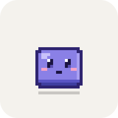
</p>

<h1 align="center">Pixel Pet</h1>

<p align="center">
  A pixel-art cube for your macOS desktop that keeps an eye on your Claude Code and Codex agents.<br>
  It shows your limits, answers quick questions, translates the selection, and can hide in the MacBook notch.
</p>

<p align="center">
  
</p>

## What it does

<table>
<tr>
<td width="25%" align="center">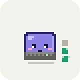</td>
<td><b>Agents at a glance.</b> Each running session is a small block next to the cube: Claude Code on the right, Codex on the left. Teal while it works, amber while it waits for you, red if it fails. A dot on a block means subagents are running. The cube types on its keyboard while anything works.</td>
</tr>
<tr>
<td align="center">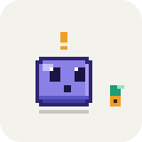</td>
<td><b>Knows when you are needed.</b> A permission prompt, a question or a plan to approve makes it bounce with a "!" until you answer.</td>
</tr>
<tr>
<td align="center"></td>
<td><b>Celebrates finished work.</b> A jump when a turn with real work ends, and a somersault with confetti after a task of 10 minutes or more.</td>
</tr>
<tr>
<td align="center">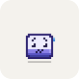</td>
<td><b>Limits.</b> The 5-hour and weekly usage show in the status panel and the menu bar. As the 5-hour window drains, the cube empties from the top. Near the limit it turns pale and sweats.</td>
</tr>
<tr>
<td align="center"></td>
<td><b>Home in the notch.</b> Drop it anywhere along the top edge of a screen and it slips into the notch, or into a small burrow on displays without one. From there only its eyes show, and it peeks out when something needs you.</td>
</tr>
<tr>
<td align="center">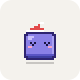</td>
<td><b>Desktop life.</b> Its eyes follow the cursor. It falls asleep when you are away, yawns and rolls now and then, gets shy when you hover over it, and gets cross if you click it too much.</td>
</tr>
</table>

<table>
<tr>
<td width="50%">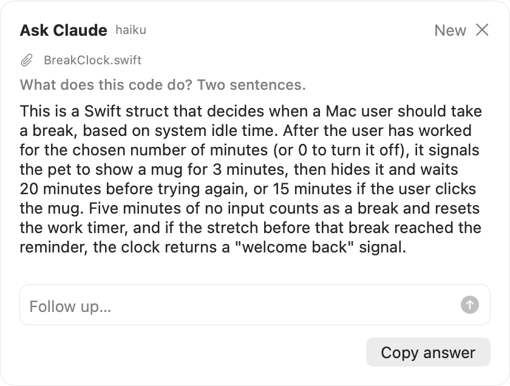</td>
<td width="50%">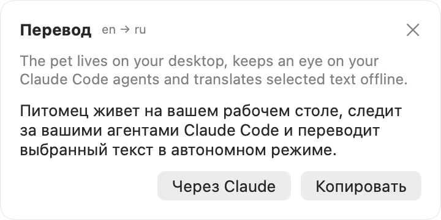</td>
</tr>
<tr>
<td><b>Quick question, ⌃⌥K.</b> Ask Claude in a card next to the cube. The answer streams in, and follow-ups continue the same conversation.</td>
<td><b>Translate the selection, ⌃⌥T.</b> Apple Translation works offline and takes about 0.2 s. "Через Claude" (via Claude) sends the text to Claude instead.</td>
</tr>
</table>

The app runs entirely on your Mac. It never talks to the network itself; the only network access is through the Claude Code CLI you already use.

> The app's UI is in Russian. Where this document names a menu item, the English meaning comes first, followed by the Russian label in quotes.

## Requirements

- macOS 26 or later, on Apple silicon or Intel.
- Swift 6.2 or later. The Command Line Tools are enough; Xcode is not required.
- [Claude Code](https://docs.claude.com/en/docs/claude-code), either as the `claude` CLI on your `PATH` or bundled with the Claude desktop app. Questions, Claude translation and limit checks use your Claude subscription.

## Install

```bash
git clone https://github.com/DiRaiks/pixel-pet.git
```

```bash
cd pixel-pet && ./scripts/install.sh
```

`install.sh` builds a release app bundle, copies it to `~/Applications/PixelPet.app` and launches it. Running it again updates the app in place. A failed build leaves the running copy alone.

On first launch, a welcome window walks you through two steps and lists the hotkeys:

1. **Connect to Claude Code** (menu: "Подключить к Claude Code…"). This adds the pet's hooks to `~/.claude/settings.json`; the file is backed up first. See [What it changes on your Mac](#what-it-changes-on-your-mac).
2. **Allow Accessibility.** This is needed only for ⌃⌥T, to read the selected text.

The first time a translation language pack is missing, the translation card offers a button to download it.

Agent sessions that are already open get picked up as soon as they send their next event. You do not need to restart them.

## Using it

### Mouse

| Action | What happens |
|---|---|
| Click the cube | It hops and opens the status panel (sessions, limits, model, context) |
| Right-click | The context menu, which matches the menu-bar menu |
| Drag | Moves the cube. A quick flick throws it across the screen |
| Drop anywhere along the top edge of a screen | It slides over and dives home into the notch, or the burrow at the top center |
| Drag it out of home | A short tug is enough; it only goes back in if you let go right where it sat |
| Hover over it for 2 s | It gets shy, at most once a minute. This happens only while it is idle on the desk with desktop reactions on and no card open |
| Click it 5 times in 3 s | It gets cross |

### Hotkeys

| Keys | Action |
|---|---|
| ⌃⌥K | Ask Claude a quick question. Esc closes the card |
| ⌃⌥T | Translate the selected text |
| ⌃⌥P | Do not disturb: the cube goes home and only comes out for errors |

### Menu bar

The menu-bar icon is a tiny cube with the number of active agents next to it. Its menu has:

- the current limits;
- the status panel;
- ask, translate and do not disturb;
- send home or let out on the desk;
- show or hide the cube;
- size (×2 to ×6);
- a state picker for previewing animations;
- connect or disconnect Claude Code, and add a statusline for the terminal;
- the event log;
- settings and the welcome window;
- quit.

### What the cube is telling you

States are listed in priority order; a higher one wins.

| | State | Meaning |
|---|---|---|
| 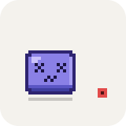 | **Error**: shakes, then gets dizzy | An agent's turn failed within the last 3 seconds |
|  | **Alert**: bounces with "!" | An agent is waiting for you: a permission prompt, a question, or a plan to approve |
|  | **Low limit**: pale, sweating | 5-hour usage is at 85% or more, or weekly usage at 90% or more |
|  | **Working**: typing | At least one agent is working |
|  | **Idle**: breathes, blinks, looks around | Nothing is going on |
|  | **Sleep**: nightcap and a bubble | Idle, and you have been away longer than the sleep setting |

On top of these, it plays one-off animations:

|  |  |  |  |
|:---:|:---:|:---:|:---:|
| A turn with 20 s+ of work finished | A task of 10 min+ finished | You clicked it, or came back | Dragged, then dropped |
|  | 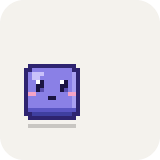 |  |  |
| Idle fidget: a yawn | Idle fidget: a roll | Cursor resting on it for 2 s | 5 clicks in 3 s |

### At the keyboard

Agents can work for hours, so the typing loop doesn't run unbroken. Every 45–120 seconds the cube has a little moment, and when an agent block changes (one finishes, fails or appears) it looks over at that side:

| 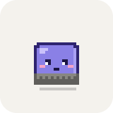 |  | 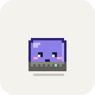 |  | 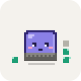 |
|:---:|:---:|:---:|:---:|:---:|
| A sip of coffee | A stretch | A pause to think, then an idea | A burst of fast typing | A look at a block that changed |

The longer the agents keep at it, the more piles up on the desk: a coffee mug after 10 minutes of work, a headband after 30. The time adds up across turns and agents; pauses of up to 10 minutes (reading an answer, writing the next message) don't count but don't clear the desk either. A longer break does.

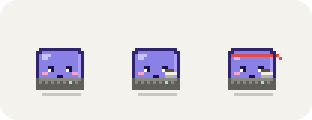

Moments and looks follow the "Desktop reactions" setting and Reduce Motion; the props always show.

While a translation card is open, it talks along: 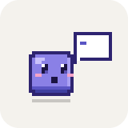

At home only the eyes show. The cube peeks out for alerts and errors, and briefly for one-off events.

Agent blocks stack beside the cube, one per session: Claude Code on the right, Codex on the left.

<p>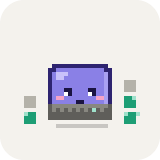</p>

| Block | Meaning |
|---|---|
| Teal, spinning | Working |
| Amber, bouncing | Waiting for you |
| Red | Failed |
| Grey | Idle |
| Green flash | Just finished |
| Dot on a block | Subagents are running |
| Ellipsis on top | More than 4 sessions on that side |

Codex blocks never turn amber: Codex doesn't write "waiting for approval" to its session files, which is where the pet reads it from.

### Examples

**A typical session.** You start three Claude Code sessions and switch to your browser.

1. Three teal blocks spin next to the cube, and it types on its keyboard. The menu bar shows `3`.
2. One agent asks to run a command it has no permission for. Its block turns amber, and the cube bounces with a "!" until you answer.
3. Twelve minutes later, the longest task finishes. Its block flashes green, and the cube does a somersault.
4. You go for lunch. With nothing running, the cube falls asleep in its nightcap, and wakes with a hop when you are back.

**Busy day, no distractions.** Press ⌃⌥P. The cube dives into the notch and stays there; only an error brings it out. Press ⌃⌥P again and it stays home but peeks out for alerts again. To bring it back to the desk, drag it out or use "Выпустить на стол" (Let out on the desk) in the menu.

**Translate a paragraph.** Select text in any app and press ⌃⌥T. Text in your language goes to the other language, anything else comes into yours. With the defaults (Russian and English), English becomes Russian and Russian becomes English.

**Quick question without a terminal.** Press ⌃⌥K, type the question, press Return. Ask a follow-up in the same card. "Новый" (New) starts a fresh conversation, and Esc closes the card.

**Limits from the terminal too.** If you have no statusline of your own, connecting adds one for terminal sessions. It feeds the pet and prints a compact line:

```text
Opus · ctx 42% · 5h 18% · 7d 9%
```

**See what the hooks report.** Turn on the event log (menu: "Записывать события") and watch it while an agent runs:

```bash
tail -f ~/.pixelpet/events.log
```

```text
2026-10-19 14:02:11.348 3f9c1a2b pixel-pet promptSubmitted
2026-10-19 14:02:13.902 3f9c1a2b pixel-pet toolStarted Bash
2026-10-19 14:02:15.117 3f9c1a2b pixel-pet toolFinished Bash
2026-10-19 14:02:15.120 3f9c1a2b pixel-pet permissionRequested
2026-10-19 14:03:40.551 3f9c1a2b pixel-pet stopped
```

Only session-id prefixes, project folder names and event names are logged.

### Settings

Open settings from the menu (menu: "Настройки…", ⌘,):

| Setting | Notes |
|---|---|
| Size | ×2 to ×6 |
| Color | Lavender, mint, peach or graphite |
| Accessory | None, glasses, headphones or a cap |
| Do not disturb | Same as ⌃⌥P |
| Desktop reactions | Eyes follow the cursor, glances at the app you switch to, the cube fades over fullscreen apps, fidgets |
| Fall asleep after | Never, or 5, 10, 15, 30 or 60 minutes without input |
| Launch at login | Uses a macOS login item |
| Claude Code hooks and statusline | Connect or disconnect them |
| Model for questions | haiku, sonnet or opus |
| Codex | Follow Codex agents and limits (on by default). Needs nothing installed |
| Event log | Writes to `~/.pixelpet/events.log` |
| Translation | Your language and the language to translate it into. Text in any other language is translated into yours |
| Accessibility | Shows the permission status, with a button to request it |

With **Reduce Motion** turned on in macOS (Accessibility → Display), the cube stops jumping, throwing and shaking. Cards open without animation. Looping alarm states hold a single expressive frame instead of animating.

Settings are stored in `~/.pixelpet/config.json`. You can edit it by hand while the app is not running:

```json
{
  "accessory" : "headphones",
  "askModel" : "haiku",
  "desktopReactions" : true,
  "doNotDisturb" : false,
  "foreignLanguage" : "en",
  "isHome" : false,
  "nativeLanguage" : "ru",
  "scale" : 4,
  "skin" : "mint",
  "sleepAfterMinutes" : 10
}
```

Missing keys fall back to defaults; the full list is in [ARCHITECTURE.md](docs/ARCHITECTURE.md#configuration).

## What it changes on your Mac

| Path | What |
|---|---|
| `~/.pixelpet/config.json` | Settings, position and the last known limits |
| `~/.pixelpet/pet.sock` | Unix socket the hooks talk to. It is readable only by you |
| `~/.pixelpet/bin/pixelpet-hook` | Hook script: `sh` and `nc` forward the hook JSON to the socket. It always exits 0 and never blocks Claude |
| `~/.pixelpet/bin/pixelpet-statusline` | Optional statusline for terminal sessions. It prints `Model · ctx N% · 5h N% · 7d N%` |
| `~/.pixelpet/events.log` | Only written when the event log is on. It rotates at 1 MB and keeps one old file, `events.log.1` |
| `~/.claude/settings.json` | One hook entry for each of 12 events, plus a `statusLine` entry only if you had none. A timestamped backup `settings.json.pixelpet-backup-<ms>` is written before every change. Other hooks are never touched |
| `~/.claude/projects/*-pixelpet-claude` | Quick-question sessions. Deleted when you start a new conversation, on quit and on launch |
| `~/.codex/sessions` | Read only: Codex session files are followed for agent status and limits. Nothing in `~/.codex` is changed |
| `$TMPDIR/pixelpet-claude` | Empty working folder for the pet's own `claude -p` runs |

Disconnecting (menu: "Отключить от Claude Code") removes the pet's hook entries, its statusline and both scripts.

**Privacy.** Hook payloads are reduced to event names, session ids, the project folder name, the tool name and the model as soon as they arrive. Prompt text and tool input are never stored. From Codex session files the pet keeps only session ids, folders, models, turn starts and ends, and limits. Selected text is read only when you press ⌃⌥T. Password fields are never read. The clipboard fallback restores your clipboard exactly, or is skipped if it cannot.

## Uninstall

1. Disconnect Claude Code from the menu.
2. If it is on, turn off "Launch at login" in Settings, so no stale entry is left under Login Items.
3. Quit the app.
4. Remove the app and its data:

```bash
rm -rf ~/Applications/PixelPet.app ~/.pixelpet
```

Two things stay behind until you remove them yourself:

- the settings backups, `~/.claude/settings.json.pixelpet-backup-*`;
- the app's entry in System Settings → Privacy & Security → Accessibility.

## Troubleshooting

- **⌃⌥T stopped reading the selection after an update.** The app is signed ad-hoc, so macOS treats every build as a new app. In System Settings → Privacy & Security → Accessibility, remove Pixel Pet with the "−" button and allow it again. A stable signing certificate fixes this for good; see [DEVELOPMENT.md](docs/DEVELOPMENT.md#code-signing).
- **No agent blocks appear.** Check that the menu says "Отключить от Claude Code", which means hooks are connected. Then turn on the event log and watch `~/.pixelpet/events.log` while an agent runs.
- **No Codex blocks or limits.** Check that "Следить за агентами Codex" is on in Settings. Blocks show up once a Codex session writes to `~/.codex/sessions`. Limits need a native Codex binary: the one inside ChatGPT.app, a standalone release in `~/.codex/packages`, or `codex` on the PATH (the npm one needs Node, which apps started from Finder don't have).
- **Limits show "unknown".** The app finds limits by running a tiny `claude -p` request. Check that Claude Code is installed and signed in.
- **A hotkey does nothing.** Hotkeys are global. If another app already owns the combination, Pixel Pet cannot register it; it only writes `hotkey N not registered` to the unified log.
- **Translation says the language is not installed.** Use the download button in the card. Alternatively, open System Settings → General → Language & Region → Translation Languages.

## Documentation

- [Architecture](docs/ARCHITECTURE.md): modules, data flow and the rules behind the states.
- [Development](docs/DEVELOPMENT.md): building, testing, debug flags and conventions.
- [Changelog](CHANGELOG.md).
- Background notes in Russian: the original [spec and plan](docs/SPEC.md), the [spike findings](docs/spike-notes.md), and the [animation prototype](docs/prototype/sprites.html), which opens in a browser.
