<p align="center">
  
</p>

<h1 align="center">Pixel Pet</h1>

<p align="center">
  <a href="https://github.com/DiRaiks/pixel-pet/actions/workflows/ci.yml"></a>
  <a href="https://github.com/DiRaiks/pixel-pet/actions/workflows/release.yml"></a>
  <a href="https://github.com/DiRaiks/pixel-pet/releases/latest"></a>
  
  
  <a href="LICENSE"></a>
</p>

<p align="center">
  A pixel-art cube on your macOS desktop. It shows what your Claude Code and Codex agents are doing,<br>
  and you can answer their permission requests without switching windows.<br>
  It also shows your usage limits, answers quick questions (also about a file), translates selected text,<br>
  reminds you to take breaks, and can hide in the MacBook notch.
</p>

<p align="center">
  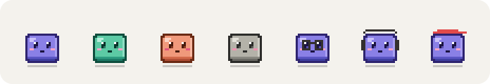<br>
  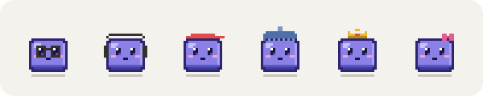<br>
  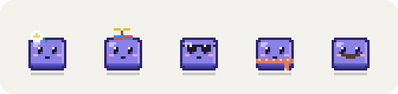
</p>

<p align="center">
  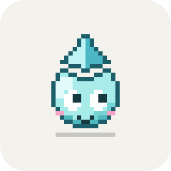<br>
  You can pick <b>LM</b> instead of the cube. Where the cube rolls, LM catches a drop or melts into a puddle:<br>
  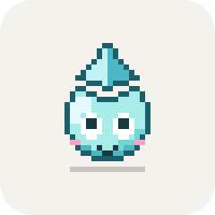
  
</p>

<p align="center">
  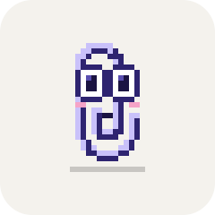<br>
  Or the <b>paperclip</b>: a bent wire with two round eyes. It comes in all the colors:<br>
  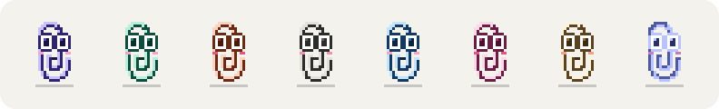
</p>

## Contents

- [What it does](#what-it-does)
- [Install](#install)
- [Agents](#agents): [blocks](#agent-blocks), [status panel](#status-panel), [permission requests](#permission-requests), [notifications](#notifications), [cube states](#cube-states), [at the keyboard](#at-the-keyboard)
- [Your day](#your-day): [breaks](#breaks), [calls](#calls), [weekly recap](#weekly-recap)
- [Ask and translate](#ask-and-translate)
- [Reacting to the Mac](#reacting-to-the-mac)
- [Noticing what you do](#noticing-what-you-do)
- [Examples](#examples)
- [Reference](#reference): [mouse](#mouse), [hotkeys](#hotkeys), [menu bar](#menu-bar), [settings](#settings)
- [What it changes on your Mac](#what-it-changes-on-your-mac), [uninstall](#uninstall), [troubleshooting](#troubleshooting)

## What it does

<table>
<tr>
<td width="25%" align="center">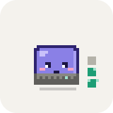</td>
<td><b>Agents at a glance.</b> Each running session is a small block next to the cube: Claude Code on the right, Codex on the left. Teal means working, amber means waiting for you, red means failed. The cube types on its keyboard while any agent works. Click the cube to see what each agent is doing now, with a timer.</td>
</tr>
<tr>
<td align="center">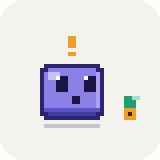</td>
<td><b>Shows when you are needed, and lets you answer.</b> When an agent asks for permission, asks a question or has a plan to approve, the cube bounces with a "!" until you answer. For a Claude Code permission request, a card opens next to the cube with the command or file and the Allow and Deny buttons. When you can't see the cube, you get a silent notification instead.</td>
</tr>
<tr>
<td align="center">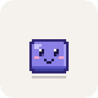</td>
<td><b>Celebrates finished work.</b> It jumps when a turn with 20 seconds or more of work ends. After a task of 10 minutes or more, it does a somersault with confetti.</td>
</tr>
<tr>
<td align="center">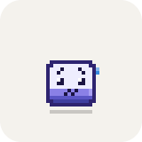</td>
<td><b>Limits.</b> The status panel and the menu show your 5-hour and weekly usage. As you use up the 5-hour window, the cube empties from the top. Near the limit, it turns pale and sweats.</td>
</tr>
<tr>
<td align="center">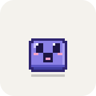</td>
<td><b>Questions, also about a file.</b> ⌃⌥K opens a card next to the cube where you ask Claude. Drop a file on the cube and it swallows it: the card opens with the file attached. ⌃⌥T translates the selected text.</td>
</tr>
<tr>
<td align="center">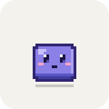</td>
<td><b>Breaks and your week.</b> After an hour without a break, it holds up a steaming mug. On Monday it reads a newspaper: a recap of what your agents did last week.</td>
</tr>
<tr>
<td align="center"></td>
<td><b>Home in the notch.</b> Drop it anywhere along the top edge of a screen and it goes into the notch. On a display without a notch, it goes into a small burrow. At home only its eyes show. It peeks out when something needs you.</td>
</tr>
<tr>
<td align="center"></td>
<td><b>Touch your YubiKey.</b> When a GPG signature (for example, a signed commit) waits for you to touch the key, the cube holds up a small YubiKey with a blinking pad. After you touch the key, it shows a check mark.</td>
</tr>
<tr>
<td align="center">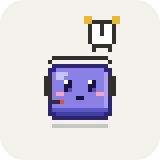</td>
<td><b>Calls.</b> With "Remind about calls" on, it puts on a headset 5 minutes before a meeting that has a call link. In the last minute, an alarm clock rings.</td>
</tr>
<tr>
<td align="center">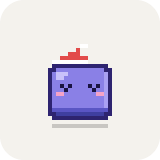</td>
<td><b>Desktop life.</b> Its eyes follow the cursor. It falls asleep when you are away, and yawns or rolls now and then. It gets shy when you hover over it and angry when you click it too often. It reacts to your Mac: headphones, music, a call, heat, a screenshot. When no agent works, it also reacts to what you do: typing, a game or a video, a USB stick, the keyboard layout.</td>
</tr>
</table>

The app runs on your Mac. It goes online only through the Claude Code CLI you already use (and the Codex CLI, to read Codex limits). The downloaded app also checks for a new version once a day. Turn this off in Settings → Updates; then the app itself never goes online.

> The interface is in English by default. Settings → Language switches it to Russian.

## Install

You need:

- macOS 26 or later, on Apple silicon or Intel.
- [Claude Code](https://docs.claude.com/en/docs/claude-code): the `claude` CLI on your `PATH`, or the one inside the Claude desktop app. Questions, translation via Claude and limit checks use your Claude subscription.

**Download:** get `PixelPet-<version>.dmg` from the [latest release](https://github.com/DiRaiks/pixel-pet/releases/latest). Open it and drag Pixel Pet into Applications. The app is signed with a Developer ID and notarized by Apple, so it opens without warnings, also offline. It updates itself: when a new version is ready, a box appears next to the cube. Click the cube to see what is new and update.

**Or build from source** with Swift 6.2 or later. The Command Line Tools are enough; you don't need Xcode.

```bash
git clone https://github.com/DiRaiks/pixel-pet.git
```

```bash
cd pixel-pet && ./scripts/install.sh
```

`install.sh` builds a release app bundle, copies it to `~/Applications/PixelPet.app` and starts it. Run it again to update the app in place. If the build fails, the running copy stays as it is. A build from source doesn't check for updates: pull and run `install.sh` again.

On first launch, a welcome window shows two steps and the hotkeys:

1. **Connect to Claude Code** (menu: "Connect to Claude Code…"). This adds the pet's hooks to `~/.claude/settings.json` and backs up the file first. See [What it changes on your Mac](#what-it-changes-on-your-mac).
2. **Allow Accessibility.** Only ⌃⌥T needs it, to read the selected text.

If a translation language pack is missing, the translation card shows a button to download it.

Agent sessions that are already open appear when they send their next event. You don't need to restart them.

## Agents

### Agent blocks

Agent blocks stack next to the cube, one per session: Claude Code on the right, Codex on the left.

<p>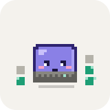</p>

| Block | Meaning |
|---|---|
| Teal, spinning | Working |
| Amber, bouncing | Waiting for you |
| Red | Failed |
| Grey | Idle |
| Green flash | Just finished |
| Dot on a block | Subagents are running |
| Ellipsis on top | More than 5 sessions on that side (4 blocks show) |

Codex blocks never turn amber. Codex doesn't write "waiting for approval" to its session files, and the pet reads Codex status from those files.

### Status panel

Click the cube to open the status panel. It shows the 5-hour and weekly limits and, for each session, what the agent is doing now, with a timer in seconds.

<p>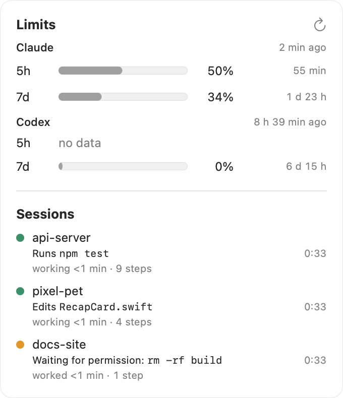</p>

- The current step: "Runs `npm test`", "Edits `App.swift`", "Searches `onGone`", "Thinking" between tools, "Waiting for permission: `rm -rf build`", "Waiting for an answer".
- Below it: how long the turn has run and how many steps it took. After the turn: "Done 5 min ago, took 12 min".
- On the right: the model, how full the context is, and "+2 sub." while subagents run.
- Codex reports no tools, so Codex rows show only the turn's timer.

### Permission requests

When Claude Code asks for permission (to run a command, change a file, open a web page or use an MCP tool), a card opens next to the cube. It shows what the agent wants to do and the model's one-line reason. The command, file or URL is in large text. Other tool parameters are in small `key: value` lines below it. You can scroll long commands inside the card.

<p>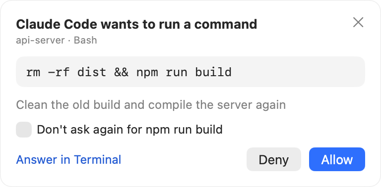</p>

- **Allow** / **Deny** answer at once. The agent continues, or gets the refusal.
- **Don't ask again** appears when Claude Code offers a rule for the request, like "Yes, don't ask again" in the terminal.
- **Answer in Terminal / VS Code / Claude** (or ✕) gives the request back. Claude Code asks in the usual place, and that app comes to the front.
- Several requests show one at a time ("1 of 2").

Details:

- In a terminal or editor, Claude Code doesn't show its own prompt while the card waits. After one minute without an answer, it does.
- The Claude app shows its own dialog at the same time. You can answer in either place; the first answer counts and the other one closes.
- The card waits only while the cube is on screen: not hidden, not covered, not in do-not-disturb.
- The buttons start to work half a second after a request appears, so a click meant for something else can't answer it.
- The command is shown only in the card. It is never stored or logged.
- Codex requests are not supported: Codex approvals don't reach the pet.

### Notifications

When you can't see the cube (it is hidden, covered or behind a fullscreen app), agents reach you through silent macOS notifications: banners with no sound or badge.

- **Needs permission** or **asks a question**, unless the permission card already shows it.
- **Done**, after a turn of 20 seconds or more of work, with how long it worked and how many steps it took.
- **Stopped with an error.**
- **Touch your YubiKey**, when a GPG signature waits for the key and the YubiKey hint is on.

Each session has at most one notification. A new one replaces the old one. It goes away when the session works again, gets its answer or ends (the YubiKey one: when you touch the key). Click a notification to bring up the app the session runs in.

Notification Center keeps a history, so notifications show only the project and what happened, never the command, file or question. macOS asks for permission the first time. Focus and the cube's do-not-disturb keep them silent. Settings → Notifications: off, when the cube can't be seen (default), or always.

### Cube states

The states are in priority order: a higher one wins.

| | State | Meaning |
|---|---|---|
| 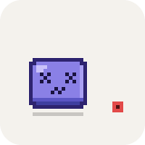 | **Error**: shakes, then gets dizzy | An agent's turn failed in the last 3 seconds |
|  | **Alert**: bounces with "!" | An agent waits for permission: a command or file change to approve |
| 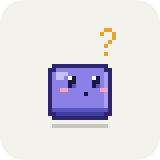 | **Question**: leans in under a "?" | An agent waits for an answer: a question, a plan to approve, or a turn that ended with a question |
|  | **Break**: a steaming mug | An hour at the Mac without five minutes away (see [Breaks](#breaks)) |
| 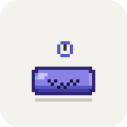 | **Spent**: lies flat, a clock ticking | A limit is used up (100%). Agents can't work until it resets |
|  | **Low limit**: pale, sweating | 5-hour usage is 85% or more, or weekly usage is 90% or more |
|  | **Working**: types in bursts of different length, looks up at the screen between them | At least one agent is working |
|  | **News**: reads a newspaper | The weekly recap is ready. Click to open it (see [Weekly recap](#weekly-recap)) |
|  | **Idle**: breathes, blinks, looks around | Nothing is happening |
| 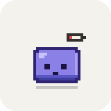 | **Tired**: droopy, a red battery | Idle on a MacBook with 20% battery or less, not plugged in |
|  | **Sleep**: nightcap and a bubble | Idle, and you have been away longer than the sleep setting |

Two things come before all of these: a YubiKey waiting for a touch, and a file held over the cube. A call that is about to start comes right after Question.

The cube also plays short one-time animations:

|  |  |  | 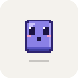 |
|:---:|:---:|:---:|:---:|
| A turn with 20 s+ of work finished | A task of 10 min+ finished | You clicked it, or came back | Dragged, then dropped |
|  | 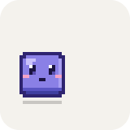 |  | 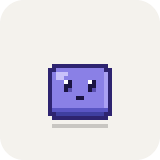 |
| Idle: a yawn | Idle: a roll (LM: a drop or a puddle) | Cursor rests on it for 2 s | 5 clicks in 3 s |
|  | 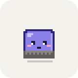 | 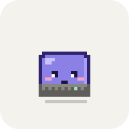 |  |
| The 5-hour limit reset | Subagents start, and come back | Claude compacts its context | Thrown hard into a wall |
|  | 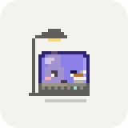 |  |  |
| Shaken while dragged | From 10 pm: a lamp and tea | A file dropped on it: swallowed | A folder or an app dropped on it |
|  | 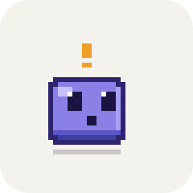 |  |  |
| A hookah break | An agent has waited for you over a minute: a wave about every 45 s | An agent's `git push` succeeded: a rocket | Petted: move the cursor back and forth over it |
|  | 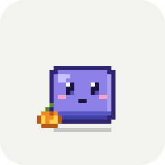 | 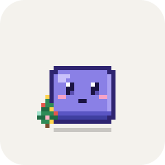 | 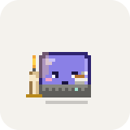 |
| Idle: a sneeze | October 25–31: a jack-o'-lantern | December 20 – January 7: a small fir tree | Every third night: a candle instead of the lamp, burning down by morning |

- When you plug in the charger, the tired cube shows a lightning bolt.
- About one in four idle animations is a hookah break. About one in three big finished tasks is also followed by one. About one hookah break in four ends in one big cloud instead of smoke rings. Turn them off with "Hookah breaks" in Settings.
- At home only the eyes show. The cube comes out for alerts and errors, and briefly for one-time events.

### At the keyboard

Agents can work for hours, so the typing is not regular. It comes in bursts of different length and speed, with pauses to look up at the screen. Every 45–120 seconds the cube does a short action. When an agent block changes (one finishes, fails or appears), the cube looks at that side.

A bubble above its head shows what the latest Claude Code agent is doing: running a command, searching, reading or editing. The bubble goes away between tools. Codex and MCP tools show no bubble.

| 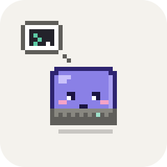 | 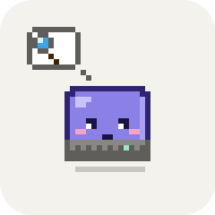 | 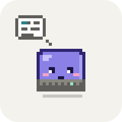 | 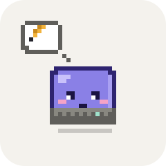 |
|:---:|:---:|:---:|:---:|
| A command (Bash) | Searching (Grep, Glob, WebSearch) | Reading (Read, WebFetch) | Editing (Edit, Write) |

|  |  |  |  | 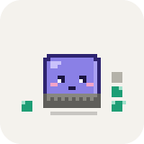 |
|:---:|:---:|:---:|:---:|:---:|
| A sip of coffee | A stretch | A pause to think, then an idea | A burst of fast typing | A look at a block that changed |

The longer the agents work, the more items appear on the desk: a coffee mug after 10 minutes of work, a headband after 30. The time adds up across turns and agents. Pauses of up to 10 minutes (when you read an answer or write the next message) don't count, and don't clear the desk. A longer pause clears it.

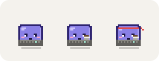

The more agents work at the same time (Claude Code and Codex together), the harder the cube types:

- 2–3 agents: two keys at a time, a drop of sweat.
- 4–5 agents: three keys, red cheeks, sweat on both sides, out of breath.
- 6 or more: steam from the top, sparks from the keys, and it shakes with each key press.

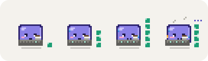

The short actions and looks follow the "Desktop reactions" setting and Reduce Motion. The desk items always show.

## Your day

### Breaks

After an hour at the Mac without five minutes away, the cube yawns, stretches and holds up a steaming mug.

- Click it for "later": the reminder comes back in 15 minutes.
- If you do nothing, the mug goes away after 3 minutes and comes back 20 minutes later, until you take a break.
- Five minutes away resets the count. When you come back from a break you needed, the cube hops.
- The mug doesn't show over an agent that needs you, an error, a fullscreen app or do-not-disturb.
- The status panel shows "No break for N" when the reminder is close.
- Any keyboard or mouse input counts as work (the same idle time the cube uses to fall asleep). The app doesn't look at what you do.

Settings → Breaks: off, or every 45, 60 (default) or 90 minutes.

### Calls

Turn on "Remind about calls" and the cube reads your Mac's calendars. 5 minutes before a meeting with a call link, it puts on a headset and an alarm clock ticks next to it. In the last minute, the clock rings. The status panel shows the next call. Click the cube to dismiss the reminder for that call. The setting is off by default. macOS asks for calendar access when you turn it on.

### Weekly recap

The cube keeps daily totals of what the agents did. On Monday morning (from 6:00, or the first time it is on the desk later that week), it opens a newspaper and reads it until you click it. The click opens last week's recap:

<p>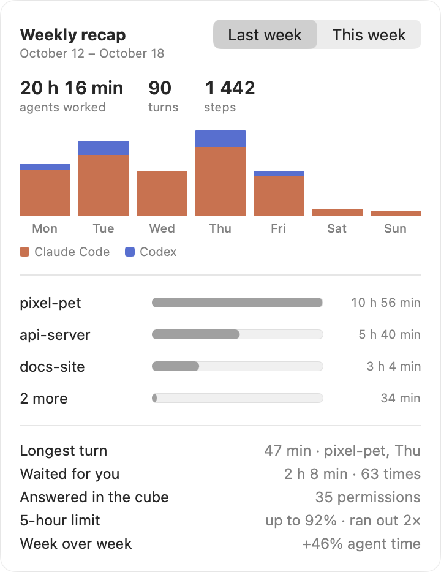</p>

- How long agents worked (time spent waiting for you is not counted), how many turns and steps, per day, with Claude Code and Codex stacked.
- The top three projects by time, and the rest together.
- The longest turn; how long and how often agents waited for you; permissions answered in the cube; the 5-hour limit's peak and how often it ran out; and the change from the week before.

The newspaper comes only if agents worked on at least two days. It waits while something else is going on (work, a waiting agent, do-not-disturb, home). The recap is also in the menu, with a switch to the current week. The totals are stored in `~/.pixelpet/stats.json`: numbers and project folder names only, no commands, files or text, kept for 8 weeks. In Settings → Weekly recap you can turn it off or clear the statistics.

## Ask and translate

<table>
<tr>
<td width="50%">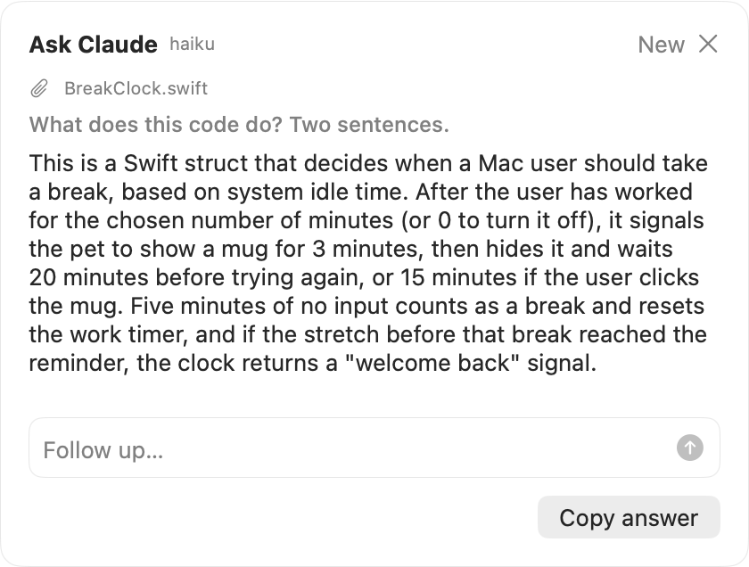</td>
<td width="50%">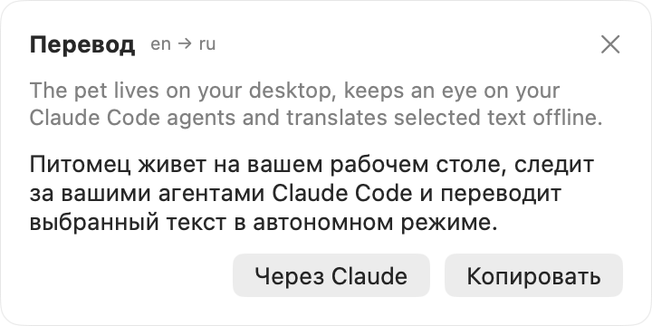</td>
</tr>
<tr>
<td><b>Quick question, ⌃⌥K.</b> Ask Claude in a card next to the cube. The answer appears as it is written, and follow-up questions continue the same conversation.</td>
<td><b>Translate the selection, ⌃⌥T.</b> Apple Translation works offline and takes about 0.2 s. "Via Claude" sends the text to Claude instead.</td>
</tr>
</table>

**Quick question.** Press ⌃⌥K, type the question and press Return. Ask follow-up questions in the same card. "New" starts a new conversation. Esc closes the card. Settings → "Model for questions" sets haiku, sonnet or opus.

**Ask about a file.** Drag a file from Finder, the desktop or Mail onto the cube. It opens its mouth while the file is over it and swallows it when you let go. The question card opens with the file attached and some suggested questions ("What's it about?", "Find bugs", "What's in the picture?"), or you can type your own. Up to 3 files at once.

- Text and code are sent as text, up to 200 000 characters. A longer file is cut, and the card tells you.
- PDFs are sent as text. A scanned PDF is sent as an image of its first page.
- Images are scaled down to 1568 px.
- For folders, archives, apps and other binary files, the cube shakes its head.

The file goes to Claude only inside the question, and only when you send it. The CLI runs with no tools, so it can't read anything else on the disk. Follow-up questions keep the files in the conversation until you click "New".

**Translate text.** Select text in any app and press ⌃⌥T. Text in your language is translated into the other language; text in any other language is translated into yours. With the defaults (Russian and English), English becomes Russian and Russian becomes English. While the translation card is open, the cube talks: 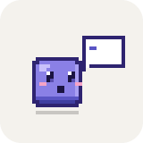

**Speak instead of typing.** Turn it on in Settings → Listening. Then press and hold the cube, or press ⌃⌥L. The cube holds a microphone toward you: waves go into it while you speak, and three dots show while you pause.  A card shows the words as they are recognized.

- When you hold the cube, listening stops when you let go.
- With ⌃⌥L, it stops when you press ⌃⌥L again, or after a 4-second pause (10 seconds if you said nothing).
- It always stops after 2 minutes.

Then the cube nods, and the card shows the text. You can correct it by hand. "Ask Claude" (Return) sends it to the question card, "Translate" to the translation card, "Copy" to the clipboard.

- macOS recognizes the speech on your Mac with its dictation model, without the network. The model for each language downloads once, the first time.
- It listens in your language from Translation, or in the language you pick in Settings → Listening.
- If the question card is open, no separate card opens: the words go into its text field and are sent as a follow-up when you finish. If an answer is still coming, they wait in the field.
- macOS asks for microphone access the first time. Nothing is recorded: the sound goes directly to the recognizer, and the text stays only in the card.

## Reacting to the Mac

The cube also reacts to what your Mac is doing. It reads only on/off signals (where sound goes, whether a mic or camera is in use, the thermal and power state, the network, the theme) and needs no permission. Screenshots are found through Spotlight, so the cube reacts after Spotlight indexes the file, and not at all if indexing is off. Any Bluetooth audio output counts as headphones. "React to the Mac" in Settings turns all of this off.

|  | 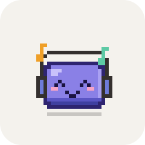 | 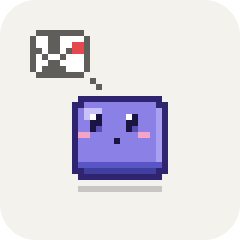 | 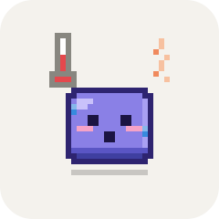 |
|:---:|:---:|:---:|:---:|
| Headphones (Bluetooth or the jack) connected: it puts them on and wears them until you disconnect them | Sound playing for 10 s+: it moves to the beat | A mic or camera in use: it stays quiet under a recording light | The Mac is hot: a thermometer, sweat |
| 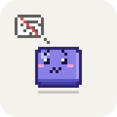 | 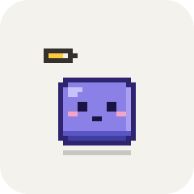 |  |  |
| No network for 5 s+ | Low power mode | Charged to 100% | A screenshot: flash, then ✌️ |
|  |  | 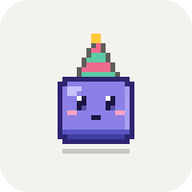 | |
| Switched to dark mode | Switched to light mode: sunglasses on | Friday from 5 pm: a party hat | |

- The ongoing states (music, on air, heat, offline, low power) replace only plain idle. Working or waiting agents, errors, calls, sleep and a low battery come first. Idle animations pause during these states.
- Between them, the order is: mic or camera, then heat, the network, low power, music.
- Virtual audio devices (loopback drivers, call apps' own devices) don't count as sound or a mic. When you unplug headphones and a paused player's stream moves to the speakers, that doesn't count as music.
- During a call (on air), the one-time reactions wait.
- Click the cube to hide the current state until it ends (the call, the music, the heat). The next state in line shows, if there is one.
- Headphones replace a hat-like accessory while you wear them.

## Noticing what you do

When no agent works, the cube also reacts to what you are doing. It reads no content and needs no permission. It uses:

- workspace notifications;
- the time since the last key press (never the keys, and only while the cube is on the desk);
- the category of the app in front;
- whether a volume is removable;
- the number of screens;
- the keyboard layout's language.

It reads these while the setting is on. It shows them only when no agent works and do-not-disturb is off. "Notice what I'm doing" in Settings turns all of this off.

| 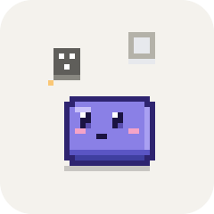 |  |  |  |
|:---:|:---:|:---:|:---:|
| You type steadily for a few seconds: keys with letters appear above it and it nods | A game in front: a gamepad | A video player in front: popcorn | Code (a terminal, an editor, Xcode) in front: glasses and a terminal |
|  |  |  |  |
| Four Space switches within 12 s: dizzy | An app opens: its icon bounces, like in the Dock | An app that was open for 30 minutes or more quits: it waves goodbye | The keyboard layout changes: the badge flips, for example EN to RU |
|  |  |  | |
| A USB stick, card or external drive connected (not a disk image) | Ejected: it waves it goodbye | A display connected: a copy of the cube waves from it | |

- The ongoing states (typing, a game, a video, code) replace only plain idle, and come after the Mac's own states (a call, heat, music). Order: a game or a video first, then typing, then code.
- An app in front counts only after you stay in it for 90 seconds.
- Click the cube to hide the current state until it ends. For typing, that is when the keys rest for a minute.
- The one-time reactions play only while no agent works. Each has a limit: dizzy and app open or quit at most every 2 minutes, USB at most every 30 seconds.
- For one minute after launch, wake or unlock, app openings, Space switches and new displays don't count, because login items and displays come back all at once.
- Spotlight, Raycast and other menu-bar apps that come to the front don't count as an app switch.

## Examples

**A typical session.** You start three Claude Code sessions and switch to your browser.

1. Three teal blocks spin next to the cube, and it types on its keyboard. The menu bar shows `3`.
2. One agent asks to run a command it has no permission for. Its block turns amber, the cube bounces with a "!", and a card next to it shows the command. You click Allow without leaving your browser.
3. Twelve minutes later, the longest task finishes. Its block flashes green, and the cube does a somersault.
4. You go to lunch. With nothing running, the cube falls asleep in its nightcap. When you come back, it wakes with a hop.

**Busy day, no distractions.** Press ⌃⌥P. The cube goes into the notch and stays there. Only an error brings it out. Press ⌃⌥P again: it stays home, but peeks out for alerts again. To bring it back to the desk, drag it out or use "Let out on the desk" in the menu.

**Limits in the terminal.** If you have no statusline of your own, connecting adds one for terminal sessions. It sends data to the pet and prints a short line:

```text
Opus · ctx 42% · 5h 18% · 7d 9%
```

**See what the hooks send.** Turn on the event log (menu: "Log events") and watch it while an agent runs:

```bash
tail -f ~/.pixelpet/events.log
```

```text
2026-10-19 14:02:11.348 3f9c1a2b pixel-pet promptSubmitted
2026-10-19 14:02:13.902 3f9c1a2b pixel-pet toolStarted Bash
2026-10-19 14:02:15.117 3f9c1a2b pixel-pet toolFinished Bash
2026-10-19 14:02:15.120 3f9c1a2b pixel-pet permissionRequested
2026-10-19 14:03:40.551 3f9c1a2b pixel-pet stopped
```

The log has only the start of session ids, project folder names and event names.

## Reference

### Mouse

| Action | What happens |
|---|---|
| Click the cube | It hops and opens the [status panel](#status-panel) |
| Right-click | Opens the menu (the same as the menu-bar menu) |
| Drag | Moves the cube. A quick flick throws it across the screen |
| Drop anywhere along the top edge of a screen | It moves into the notch, or into the burrow at the top center |
| Drag it out of home | A short pull is enough. It goes back in only if you let go where it was |
| Drop a file on it | It swallows the file and the question card opens with it attached ([ask about a file](#ask-and-translate)) |
| Press and hold it | With listening on, it listens to the mic until you let go. The words go to a card ([speak instead of typing](#ask-and-translate)) |
| Hover over it for 2 s | It gets shy, at most once a minute. Only when it is idle on the desk, "Desktop reactions" is on and no card is open |
| Move the cursor back and forth over it | It purrs |
| Click it 5 times in 3 s | It gets angry |
| Click it while it holds up the mug | "Later": the break reminder comes back in 15 minutes |
| Click it while it reads the newspaper | Opens the weekly recap |
| Click it while it gets ready for a call | Dismisses the reminder for that call (the status panel doesn't open) |
| Click it during a Mac or activity state (music, on air, heat, offline, a gamepad, popcorn, code, typing) | Hides that state until it ends |

### Hotkeys

| Keys | Action |
|---|---|
| ⌃⌥K | Ask Claude a quick question. Esc closes the card |
| ⌃⌥T | Translate the selected text |
| ⌃⌥L | Listen to the mic (when turned on in Settings). Press again to finish |
| ⌃⌥P | Do not disturb: the cube goes home and comes out only for errors |

### Menu bar

The menu-bar icon is a small cube with the number of active agents next to it. The menu has:

- the current limits;
- the status panel and the weekly recap;
- ask, translate, listen and do not disturb;
- send home, or let out on the desk;
- show or hide the cube;
- size (×2 to ×6);
- a state picker to preview animations;
- connect or disconnect Claude Code, and add a statusline for the terminal;
- the event log;
- settings and the welcome window;
- quit.

### Settings

Open Settings from the menu ("Settings…", ⌘,). The table follows the sections of the Settings window.

| Setting | Notes |
|---|---|
| **Pet** | |
| Language | English (default) or Russian. Changes the whole interface at once |
| Size | ×2 to ×6 |
| Character | The cube, LM (a drop under a diamond) or the paperclip. LM has his own aqua colors and no accessory, so Color and Accessory are disabled for him. The paperclip uses the color but has no accessory |
| Color | Lavender, mint, peach, graphite, sky, sakura, vanilla, night (dark, for dark wallpapers), or "New every day" |
| Accessory | None, glasses, sunglasses, headphones, cap, beanie, crown, bow, flower, propeller hat, scarf, mustache, or "New every day" |
| Do not disturb | Same as ⌃⌥P |
| Desktop reactions | Eyes follow the cursor, looks at the window you switch to, the cube fades over fullscreen apps, idle animations |
| React to the Mac | Headphones, music, mic or camera in use, heat, low power, the network, a full battery, screenshots, the theme, Friday evening (on by default) |
| Notice what I'm doing | Spaces, typing, games, videos and code in front, apps opening and quitting, USB sticks, a new display, the keyboard layout (on by default) |
| Hookah breaks | On by default |
| Fall asleep after | Never, or 5, 10, 15, 30 or 60 minutes without input |
| Launch at login | Uses a macOS login item |
| **Claude Code** | |
| Hooks and terminal statusline | Connect or disconnect them |
| Model for questions | haiku, sonnet or opus |
| Answer permission requests in the pet | A card next to the cube for Claude Code permission requests (on by default) |
| Event log | Writes to `~/.pixelpet/events.log` |
| **Calls** | |
| Remind about calls | Reminders from the Mac's calendars (off by default). Shows the access status and how many calendars the cube can see |
| **Notifications** | Off, when the cube can't be seen (default), or always. Shows a link to System Settings if macOS has turned them off |
| **Breaks** | Remind about a break after 45, 60 (default) or 90 minutes of work, or off |
| **Updates** | Downloaded app only. Check for a new version once a day (on by default; off makes no requests at all). Install updates automatically (off by default). The menu also has "Check for Updates…" |
| **Weekly recap** | Keep daily totals for the recap and the Monday newspaper (on by default). Clear the statistics |
| **YubiKey** | Show when the key waits for a touch (on by default). Also send a notification then, even when you can see the cube (on by default; off shows it only on the cube) |
| **Codex** | "Follow Codex agents": Codex blocks and Codex limits (on by default). Reads `~/.codex/sessions` and installs nothing |
| **Translation** | Your language and the language to translate it into. Text in any other language is translated into yours. Also shows the Accessibility permission status, with a button to request it |
| **Listening** | Off by default. When on: press and hold the cube or press ⌃⌥L to listen. Also sets the language you speak (by default, your language from Translation) |

With **Reduce Motion** on in macOS (Accessibility → Display), the cube doesn't jump, get thrown or shake. Cards open without animation. Repeating alert states show one still frame.

Settings are stored in `~/.pixelpet/config.json`. You can edit it by hand while the app is not running:

```json
{
  "accessory" : "headphones",
  "askModel" : "haiku",
  "breakMinutes" : 60,
  "desktopReactions" : true,
  "doNotDisturb" : false,
  "foreignLanguage" : "en",
  "isHome" : false,
  "nativeLanguage" : "ru",
  "notifications" : "whenHidden",
  "scale" : 4,
  "skin" : "mint",
  "sleepAfterMinutes" : 10,
  "uiLanguage" : "en"
}
```

Missing keys use the defaults. The full list is in [ARCHITECTURE.md](docs/ARCHITECTURE.md#configuration).

## What it changes on your Mac

| Path | What |
|---|---|
| `~/.pixelpet/config.json` | Settings, position and the last known limits |
| `~/.pixelpet/stats.json` | Daily totals for the weekly recap: agent time, turns and steps per project folder, waits, answers in the cube, the 5-hour limit's peak. No text. Kept for 8 weeks. Written at most once a minute |
| `~/.pixelpet/pet.sock` | Unix socket the hooks connect to. Only you can read it |
| `~/.pixelpet/bin/pixelpet-hook` | Hook script. It uses `sh` and `nc` to send the hook JSON to the socket and always exits 0. Only a permission request waits for the pet's answer: up to a minute, or not at all if the pet isn't running, is hidden, is in do-not-disturb or the setting is off. Only for a permission request does the script print the answer |
| `~/.pixelpet/bin/pixelpet-statusline` | Optional statusline for terminal sessions. It prints `Model · ctx N% · 5h N% · 7d N%` |
| `~/.pixelpet/events.log` | Written only when the event log is on. At 1 MB it rotates and keeps one old file, `events.log.1` |
| `~/.claude/settings.json` | One hook entry for each of 13 events, and a `statusLine` entry only if you had none. Before every change, the app writes a backup `settings.json.pixelpet-backup-<ms>`. Other hooks are never changed |
| `~/.claude/projects/-…-T-pixelpet-claude` | Quick-question sessions. The Claude Code CLI writes them in a folder named after `$TMPDIR/pixelpet-claude`, including the text of files you dropped on the cube. Deleted when you start a new conversation, on quit and on launch. Only this exact folder (and the one older builds used for the limits check) is ever deleted |
| `~/.claude/projects/<project>/<session>.jsonl` | Read only: the end of a session's transcript. Read while a permission request waits (to see if you answered in Claude Code itself), and when a working session is quiet for a few seconds (to see if you stopped the turn with Esc, which no hook reports). Only the tool call's result and an "interrupted" line are checked. Nothing is kept |
| Microphone | Only with listening on in Settings, and only while listening (press and hold, ⌃⌥L). The sound goes directly to macOS on-device speech recognition and is never recorded. The text stays in the card |
| Calendars | Read only, when call reminders are on: events for the next day, kept in memory. Titles are shown in the status panel and never written anywhere |
| System log | Read only, one message: the smart-card service's "Time extension received", through a filtered `log stream` that stops when the app quits |
| What you do | Read only, while "Notice what I'm doing" is on: the app in front and its category, apps opening and quitting, Space switches, removable volumes (and whether one is a disk image), the number of screens, the keyboard layout's language, and, while the cube is on the desk, the time since the last key press (never which keys). Nothing is kept or written |
| `~/.codex/sessions` | Read only: the pet follows Codex session files for agent status and limits. Nothing in `~/.codex` is changed |
| `$TMPDIR/pixelpet-claude` | Empty working folder for the pet's own `claude -p` runs |
| Notifications | macOS asks the first time one is sent (banners only, no sound or badge). Notification Center keeps a history, so they show only the project and what happened |
| Updates | Downloaded app only, unless turned off: once a day, a request for `appcast.xml` from the latest GitHub release, with no data about you. Before an update replaces the app, it is checked against Sparkle's EdDSA key built into the app and the same Developer ID. Sparkle keeps its own settings (last check time, a skipped version) in the app's defaults |

To disconnect, use "Disconnect from Claude Code" in the menu. It removes the pet's hook entries, its statusline and both scripts.

**Privacy.**

- When a hook payload arrives, the app keeps only the event name, session id, project folder name, tool name and model. For the status panel it also keeps a few words about the current step (the first line of a command, a file name without its path, a URL's host), in memory only.
- A permission request's command or file is shown in its card and dropped after you answer.
- Prompt text and tool input are never written anywhere. The event log and the weekly stats get none of it.
- Files dropped on the cube go to Claude only inside a question you send.
- From Codex session files, the pet keeps only session ids, folders, models, turn starts and ends, and limits.
- Selected text is read only when you press ⌃⌥T. Password fields are never read. If the app has to use the clipboard to read the selection, it restores your clipboard exactly, or doesn't use it if it can't.

## Uninstall

1. Disconnect Claude Code from the menu.
2. If "Launch at login" is on, turn it off in Settings, so no old entry stays in Login Items.
3. Quit the app.
4. Remove the app and its data (the DMG installs to `/Applications`, `install.sh` to `~/Applications`):

```bash
rm -rf /Applications/PixelPet.app ~/Applications/PixelPet.app ~/.pixelpet
```

Two things stay until you remove them yourself:

- the settings backups, `~/.claude/settings.json.pixelpet-backup-*`;
- the app's entries in System Settings → Privacy & Security → Accessibility, and in System Settings → Notifications.

## Troubleshooting

- **⌃⌥T stopped reading the selection after an update.** A build from source is signed ad-hoc unless a signing certificate is set up, so macOS treats every build as a new app. In System Settings → Privacy & Security → Accessibility, remove Pixel Pet with the "−" button and allow it again. A stable signing certificate fixes this; see [DEVELOPMENT.md](docs/DEVELOPMENT.md#code-signing).
- **No agent blocks appear.** Check that the menu shows "Disconnect from Claude Code": this means the hooks are connected. Then turn on the event log and watch `~/.pixelpet/events.log` while an agent runs.
- **No Codex blocks or limits.** Check that "Follow Codex agents" is on in Settings. Blocks appear when a Codex session writes to `~/.codex/sessions`. Limits need a native Codex binary: the one inside ChatGPT.app, a standalone release in `~/.codex/packages`, or `codex` on the PATH. The npm version needs Node, which apps started from Finder don't have.
- **Limits show "unknown".** The app reads limits with a very small `claude -p` request. Check that Claude Code is installed and signed in.
- **No notifications.** Settings → Notifications shows if macOS has turned them off for Pixel Pet, with a button to System Settings. With "When the cube can't be seen", they come only while the cube is hidden, covered or behind a fullscreen app.
- **A hotkey does nothing.** Hotkeys are global. If another app already uses the key combination, Pixel Pet can't register it. It only writes `hotkey N not registered` to the unified log.
- **The cube doesn't show the YubiKey.** The app reads the touch request from the macOS smart-card service. GnuPG uses this service when it talks to the key through PC/SC (the usual setup on macOS). If `scdaemon` uses GnuPG's own CCID driver instead, nothing reaches the system log. FIDO2 touches (`sk-` SSH keys, passkeys) are not supported yet.
- **No call reminders.** The cube reads only the calendars macOS knows about. Apps with their own sync (for example, Notion Calendar) don't put their events there. Add the same Google or Microsoft account in System Settings → Internet Accounts with Calendars on. Settings → "Calls" shows how many calendars the cube can see. Only events with a call link (Zoom, Meet, Teams, Webex, Jitsi, Whereby, FaceTime, Slack huddles) count. All-day, cancelled and declined events don't count.
- **Translation says the language is not installed.** Use the download button in the card, or open System Settings → General → Language & Region → Translation Languages.

## Documentation

- [Architecture](docs/ARCHITECTURE.md): modules, data flow and how states are chosen.
- [Development](docs/DEVELOPMENT.md): building, testing, debug flags and conventions.
- [Changelog](CHANGELOG.md).
- The original [animation prototype](docs/prototype/sprites.html). It opens in a browser.

## License

The code is released under the [MIT License](LICENSE). LM's look is based on a mascot that belongs to its owners. The license covers the code that draws it, not the character itself.
